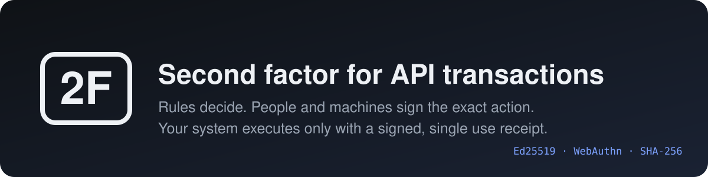
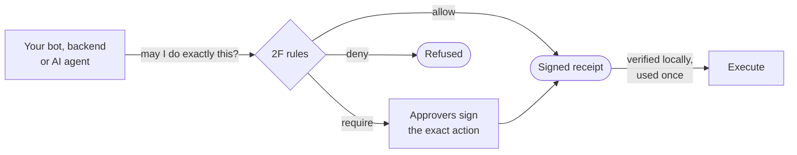
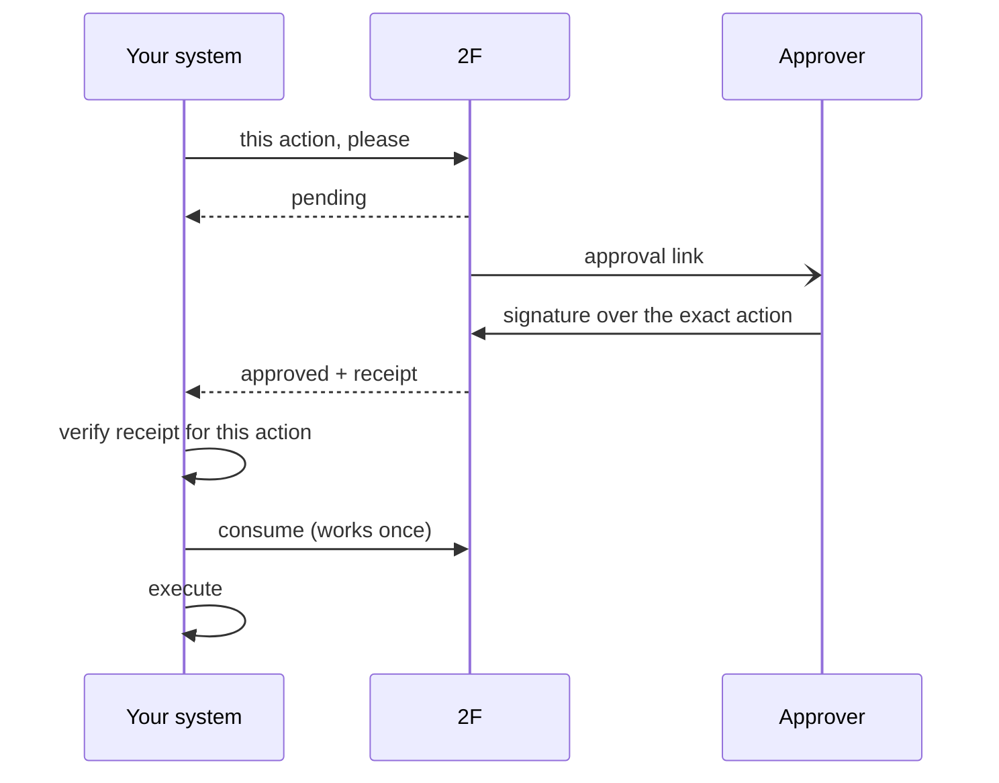
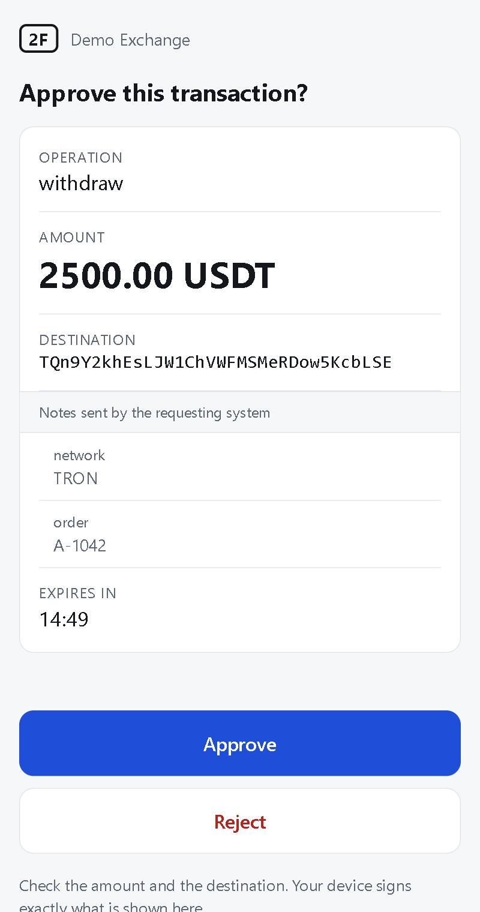
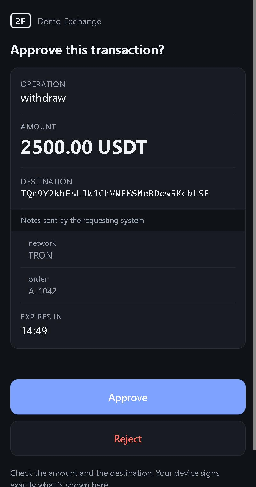
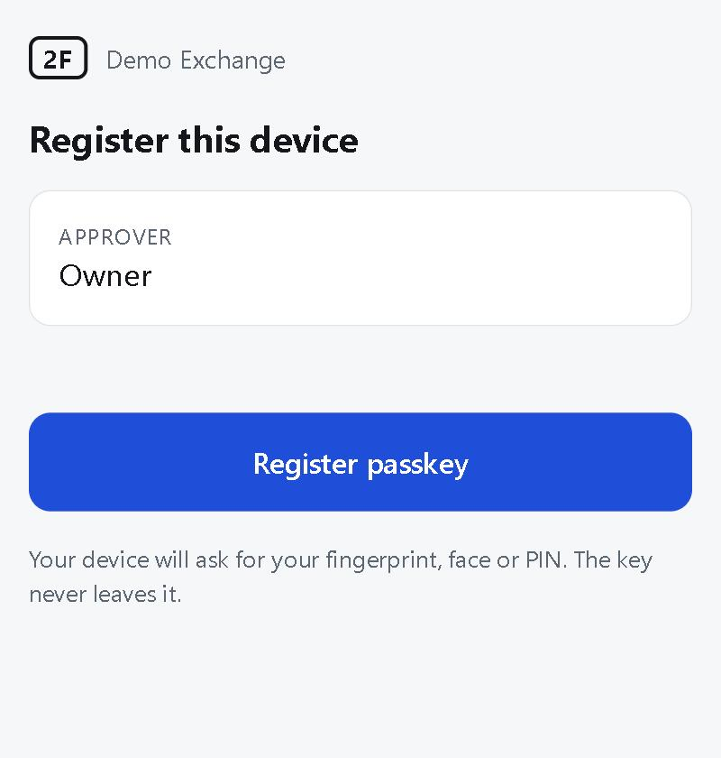

<p align="center">
  
</p>

<p align="center">
  <a href="https://github.com/zanzarini/2f/actions/workflows/ci.yml"></a>
  
  
  
</p>

<p align="center">
  <b>English</b> · <a href="README.pt-BR.md">Português</a>
</p>

Ordinary 2FA protects a person logging in. When a transfer is triggered by a
bot, an integration or an AI agent, there is usually no second factor at all,
or it is a second secret sitting on the same server.

**2F is a small self hosted service your system asks before executing:
_may I do exactly this?_**

- **Rules** decide whether an action passes alone, needs approval, or is refused.
- **Approvers** sign the exact action (amount, asset, destination) with a key
  that never leaves them: a passkey, a device key, or an independent co-signer
  machine.
- **Your system** gets a signed receipt bound to that action, valid for
  minutes and usable once.
- **Every event** lands in a signed, hash chained audit log.

It is not "unbreakable", and it does not claim to be. The
[threat model](docs/THREAT_MODEL.md) says what an attacker can and cannot do in
each scenario, and names the tests behind each claim.

## How it works





More maps, including what is signed by whom and how the storage engine batches
commits, are in **[docs/ARCHITECTURE.md](docs/ARCHITECTURE.md)**.

## What the approver sees

<p align="center">
  
  &nbsp;&nbsp;
  
  &nbsp;&nbsp;
  
</p>

The page is served by 2F itself: no app to install. The device signs exactly
what is on screen, and the signature is useless for any other action.

## Quick start

```bash
cargo build --release
twof init                                   # creates twof.db and twof.key
PROJECT=$(twof project create "My exchange")
twof policy set $PROJECT examples/policy.json
twof apikey create $PROJECT                 # shown once
twof approver add $PROJECT alice
twof credential invite $PROJECT alice       # link to register a passkey
twof pubkey                                 # pin this in your clients
twof serve
```

`bash scripts/demo.sh` starts a throwaway server and prints a registration
link and an approval link to try in a browser.

## Integrating

<table>
<tr><th>TypeScript</th><th>Python</th></tr>
<tr><td>

```js
import { TwoF } from "twof-client";

const twof = new TwoF({ url, apiKey,
  publicKeys: { [kid]: publicKey } });

const action = { type: "withdraw",
  amount: "2500.00", asset: "USDT",
  destination: "0xabc..." };

const result = await twof.authorize(action,
  { idempotencyKey: "withdraw-A-1042" });

if (result.authorized) {
  await twof.consume(result.receipt);
  await sendWithdrawal(action);
}
```

</td><td>

```python
from twof import TwoF

twof = TwoF(url, api_key,
            public_keys={kid: public_key})

action = {"type": "withdraw",
          "amount": "2500.00", "asset": "USDT",
          "destination": "0xabc..."}

result = twof.authorize(
    action, idempotency_key="withdraw-A-1042")

if result.authorized:
    twof.consume(result.receipt)
    send_withdrawal(action)
```

</td></tr>
</table>

Both clients verify the receipt locally, against the pinned server key and the
action you are about to execute. Amounts are always decimal strings, never
numbers.

## Rules

Evaluated in order; the first match decides; no match means deny.
A complete example is in [examples/policy.json](examples/policy.json).

| Condition | Matches when |
|---|---|
| `type`, `asset` | the action's value is in the list |
| `amount_min`, `amount_max` | the amount is inside the range |
| `destination_in` | the destination is in one of the named lists |
| `velocity` | this amount plus what was already authorized in the window stays under `max_total` |
| `hours_utc` | the current UTC hour is inside the range |

| Outcome | Effect |
|---|---|
| `allow` | receipt issued immediately |
| `deny` | refused |
| `require` | waits for approvers: `count` distinct people, optionally restricted by `kinds`, `approvers`, `min_strength` |

## Approval channels

| Kind | What it is |
|---|---|
| `passkey` | fingerprint, face or PIN on a phone or computer, through the built in page |
| `ed25519` | a device key for command line or app approvers. `twof device approve` shows the action and signs the hash it computes itself |
| `cosigner` | a second machine with its own key and its own policy (`twof cosign`) |
| Telegram | a message with the approval link. It notifies; it never approves |
| Webhooks | `challenge.pending`, `approved`, `rejected`, `expired`, signed with the server key |

## Built to hold

| | |
|---|---|
| **Bound to the action** | Receipts and approvals cover the SHA-256 of a canonical form. Change one digit of the amount and nothing verifies. |
| **Nothing to steal in the database** | Public keys and hashes only. The signing key lives outside it. |
| **Nothing to plant in the database** | Credentials, API keys, policies, enrollment links and every challenge are sealed with the server key. A row written by someone else is ignored; an edited policy denies everything; a planted approval does not count. |
| **Signed audit log** | Hash chained and signed entry by entry. `twof audit verify` reports edits, deletions and grants that the log does not explain. |
| **Does not trust itself** | Clients can pin device and co-signer keys and check their signatures inside the receipt, and the approval page and terminal approver recompute what they sign, so even a compromised 2F server cannot invent one of those approvals. |
| **Fast** | Group commit and a read pool: about 3,000 durable authorizations per second and 450,000 reads per second in the [benchmark](docs/ARCHITECTURE.md#7-why-it-is-fast), on a laptop. |

## Deploying

The `Dockerfile` builds a single binary image that listens on port 8722 and
keeps its data in `/data`. Put it behind HTTPS (passkeys require it outside
`localhost`) and set:

| Variable | Purpose |
|---|---|
| `TWOF_PUBLIC_URL` | the address approvers open, for example `https://2f.example.com` |
| `TWOF_KEY` | signing key seed in hex, as a secret, so it does not live next to the database |
| `TWOF_TELEGRAM_BOT_TOKEN` | optional, for Telegram notifications |

Run `twof audit verify` to check the log, and `twof audit checkpoint` on a
schedule, storing its output somewhere the server cannot write.

## Repository map

| Path | What is there |
|---|---|
| [`crates/core`](crates/core/src) | Canonical JSON, rules, receipts, passkey verification, audit chain, seals. No IO. |
| [`crates/server`](crates/server/src) | HTTP API, operations, storage engine, deliveries, co-signer. |
| [`crates/cli`](crates/cli/src) | The `twof` command. |
| [`web`](web) | The approval and registration page. |
| [`sdk/ts`](sdk/ts), [`sdk/python`](sdk/python) | Clients. |
| [`docs`](docs) | [Architecture](docs/ARCHITECTURE.md), [protocol](docs/PROTOCOL.md), [threat model](docs/THREAT_MODEL.md). |
| [`scripts`](scripts) | End to end test and demo. |

## Development

```bash
cargo test --workspace        # unit, attack, tamper and concurrency tests
bash scripts/e2e.sh           # real server, real HTTP, co-signer included
(cd sdk/ts && node --test)
(cd sdk/python && python -m unittest)
```

`sdk/vectors.json` is generated by the Rust core and checked by both SDKs, so
the three implementations cannot drift apart. See
[CONTRIBUTING.md](CONTRIBUTING.md), and [SECURITY.md](SECURITY.md) to report a
vulnerability.

## License

[Apache-2.0](LICENSE).
