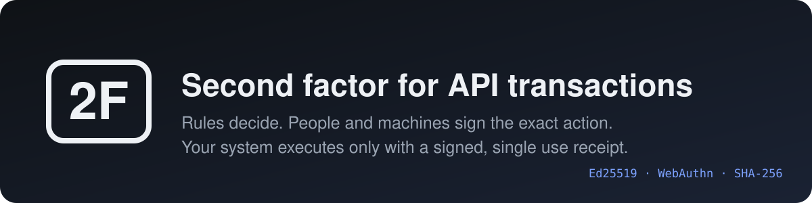
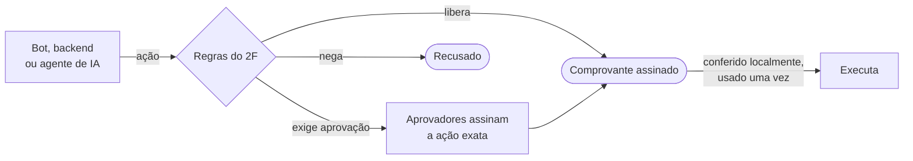
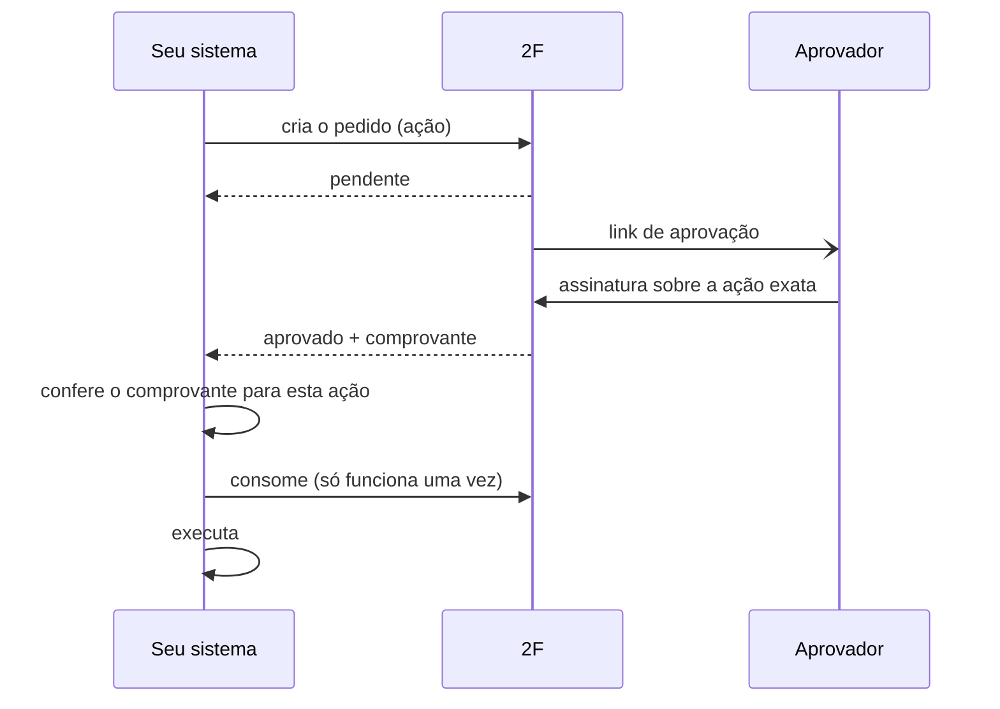
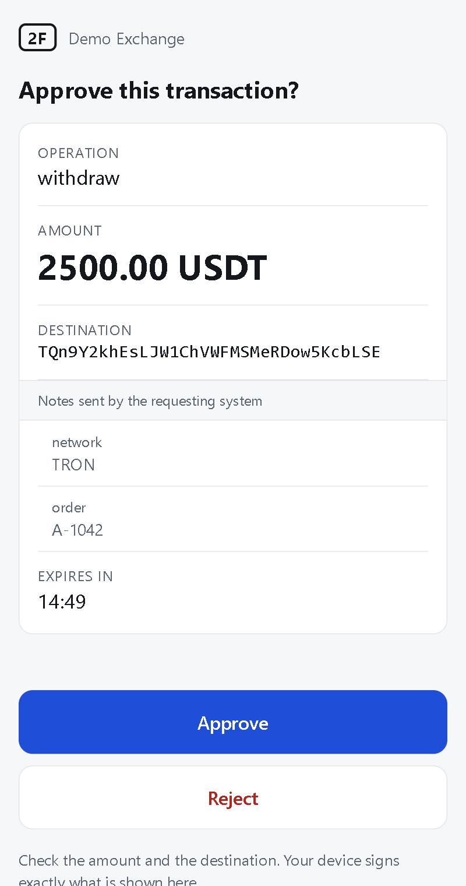
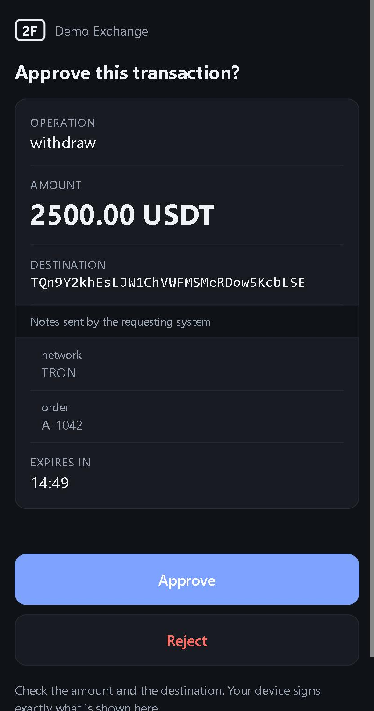
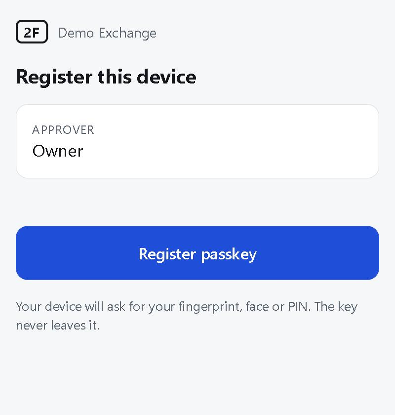

<p align="center">
  
</p>

<p align="center">
  <a href="README.md">English</a> · <b>Português</b>
</p>

O 2F é um serviço de autorização auto-hospedado para transações iniciadas por
API, por bots, integrações ou agentes de IA. Antes de executar, o sistema envia
a ação exata ao 2F e só prossegue com um comprovante assinado para ela.

- **Regras** decidem se a ação passa sozinha, precisa de aprovação ou é negada.
- **Aprovadores** assinam a ação exata (valor, ativo, destino) com uma chave
  que nunca sai deles: passkey, chave de dispositivo ou uma máquina
  co-assinadora independente.
- **O seu sistema** recebe um comprovante assinado, amarrado àquela ação,
  válido por minutos e de uso único.
- **Todo evento** vai para um registro de auditoria assinado e encadeado.

O [modelo de ameaças](docs/THREAT_MODEL.md) descreve o que um invasor consegue
e não consegue em cada cenário de comprometimento e indica os testes que
sustentam cada afirmação.

## Como funciona





Os demais diagramas (cadeia de assinaturas, ciclo de vida de um pedido,
mecanismo de armazenamento) estão em
[docs/ARCHITECTURE.md](docs/ARCHITECTURE.md), em inglês.

## Página de aprovação

<p align="center">
  
  &nbsp;&nbsp;
  
  &nbsp;&nbsp;
  
</p>

A página é servida pelo próprio 2F, não exige aplicativo e é exibida em
português quando o aparelho está em português. O dispositivo assina a ação
exibida, e a assinatura não é válida para nenhuma outra ação.

## Início rápido

```bash
cargo build --release
twof init                                   # cria twof.db e twof.key
PROJECT=$(twof project create "Minha corretora")
twof policy set $PROJECT examples/policy.json
twof apikey create $PROJECT                 # aparece uma única vez
twof approver add $PROJECT alice
twof credential invite $PROJECT alice       # link para cadastrar a passkey
twof pubkey                                 # fixe este valor nos seus clientes
twof serve
```

`bash scripts/demo.sh` inicia um servidor temporário e exibe um link de
cadastro e um de aprovação para uso no navegador.

## Regras

Avaliadas em ordem; a primeira que casar decide; se nenhuma casar, nega.
Exemplo completo em [examples/policy.json](examples/policy.json).

| Condição | Casa quando |
|---|---|
| `type`, `asset` | o valor da ação está na lista |
| `amount_min`, `amount_max` | o valor está dentro da faixa |
| `destination_in` | o destino está em uma das listas nomeadas |
| `velocity` | este valor somado ao que já foi autorizado na janela não passa de `max_total` |
| `hours_utc` | a hora atual (UTC) está dentro da faixa |

| Resultado | Efeito |
|---|---|
| `allow` | comprovante emitido na hora |
| `deny` | recusado |
| `require` | espera aprovadores: `count` pessoas diferentes, com filtros opcionais `kinds`, `approvers`, `min_strength` |

## Canais de aprovação

| Tipo | O que é |
|---|---|
| `passkey` | digital, rosto ou PIN no celular ou computador, pela página embutida |
| `ed25519` | chave de dispositivo para aprovar por linha de comando ou aplicativo. `twof device approve` mostra a ação e assina o hash que ele mesmo calcula |
| `cosigner` | uma segunda máquina, com chave, regras e total acumulado próprios (`twof cosign`). Só conta onde a regra pede por ela |
| Telegram | mensagem com o link de aprovação. Avisa, nunca aprova |
| Webhooks | eventos assinados com a chave do servidor |

## Propriedades de segurança

| | |
|---|---|
| **Vinculado à ação** | Comprovantes e aprovações cobrem o SHA-256 de uma forma canônica. A alteração de um único dígito do valor invalida ambos. |
| **Banco sem segredos** | Só chaves públicas e hashes. A chave de assinatura fica fora dele. |
| **Registros selados** | Credenciais, chaves de API, regras, links de cadastro e cada pedido levam um selo da chave do servidor. Linha escrita por outra pessoa é ignorada; regra adulterada nega tudo; aprovação plantada não conta. |
| **Registro de auditoria como fonte** | Encadeado e assinado entrada por entrada. O servidor tira dele o que está valendo, então credencial revogada ou regra substituída não volta pelas tabelas, e ele para se o registro for cortado ou alterado. `twof audit verify` aponta o que o registro não explica. |
| **Verificação independente** | O cliente pode fixar as chaves de dispositivo e de co-assinador e conferir as assinaturas dentro do comprovante, e a página e o aprovador de terminal recalculam o que assinam, então nem um servidor 2F invadido inventa uma dessas aprovações. |
| **Desempenho** | Gravação em lote e leituras em paralelo: cerca de 3.000 autorizações duráveis por segundo e 450.000 leituras por segundo na [medição](docs/ARCHITECTURE.md#7-performance) em um notebook. |

## Implantação

O `Dockerfile` gera uma imagem com um único binário, na porta 8722, com os
dados em `/data`. Coloque atrás de HTTPS (passkey exige isso fora de
`localhost`) e configure:

| Variável | Finalidade |
|---|---|
| `TWOF_PUBLIC_URL` | o endereço que os aprovadores abrem, por exemplo `https://2f.exemplo.com` |
| `TWOF_KEY` | semente da chave de assinatura em hexadecimal, como segredo, para não ficar ao lado do banco |
| `TWOF_TELEGRAM_BOT_TOKEN` | opcional, para os avisos no Telegram |

Rode `twof audit verify` para conferir o registro e `twof audit checkpoint`
periodicamente, guardando a saída em um lugar onde o servidor não escreve.

## Licença

[Apache-2.0](LICENSE).
