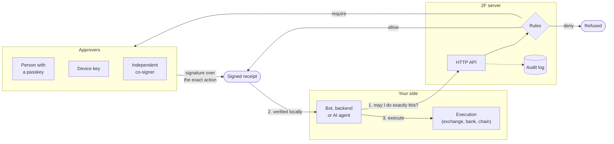
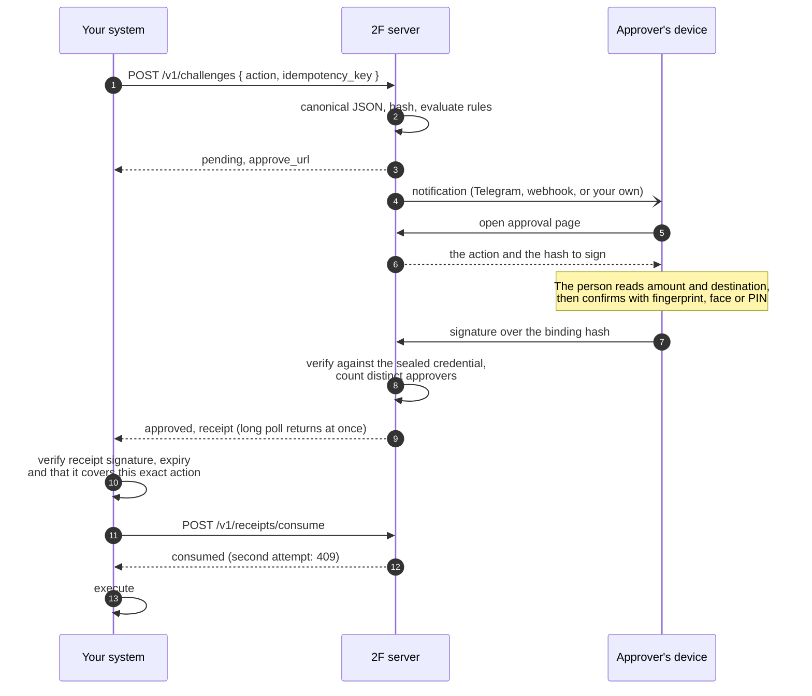
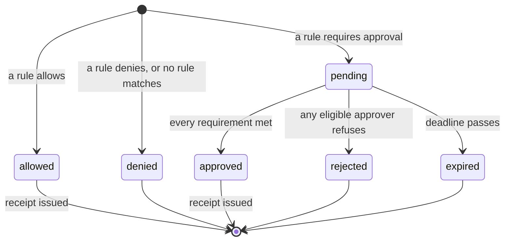
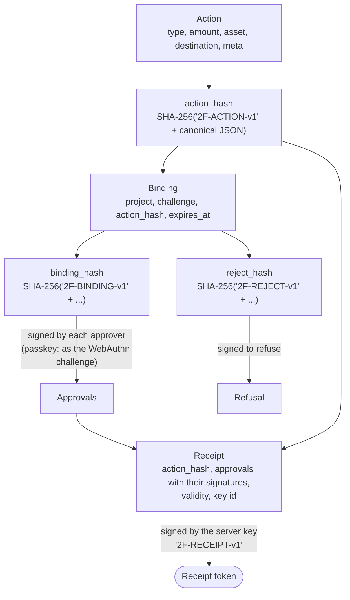
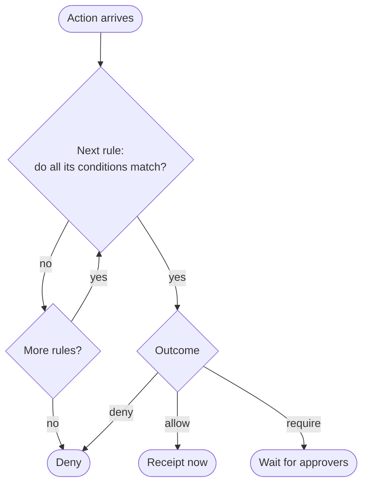
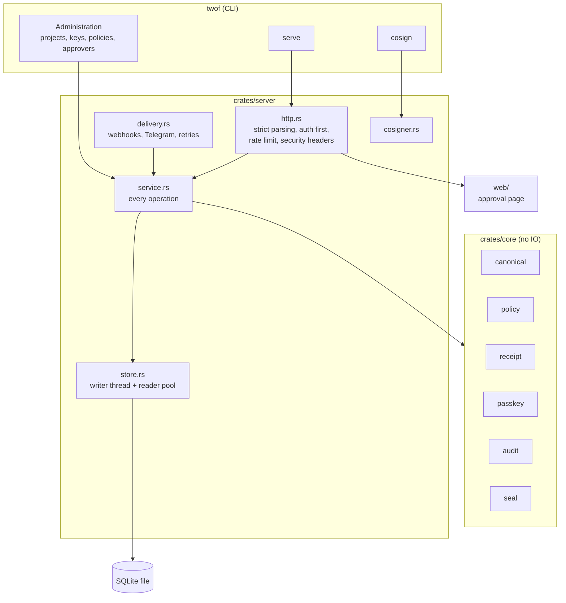
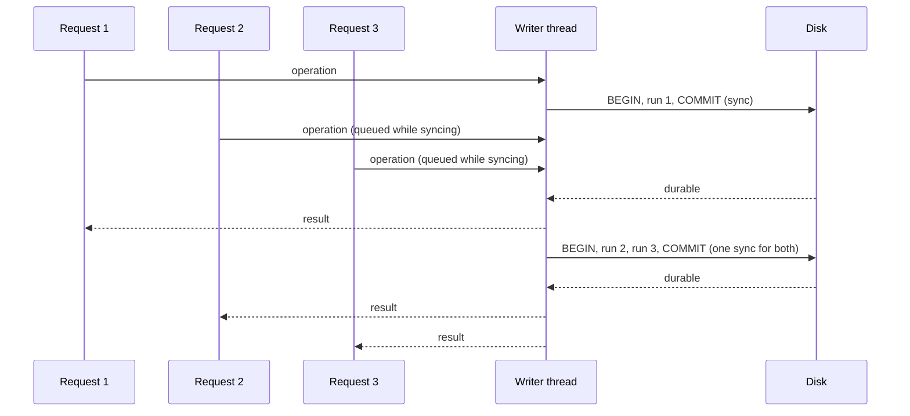
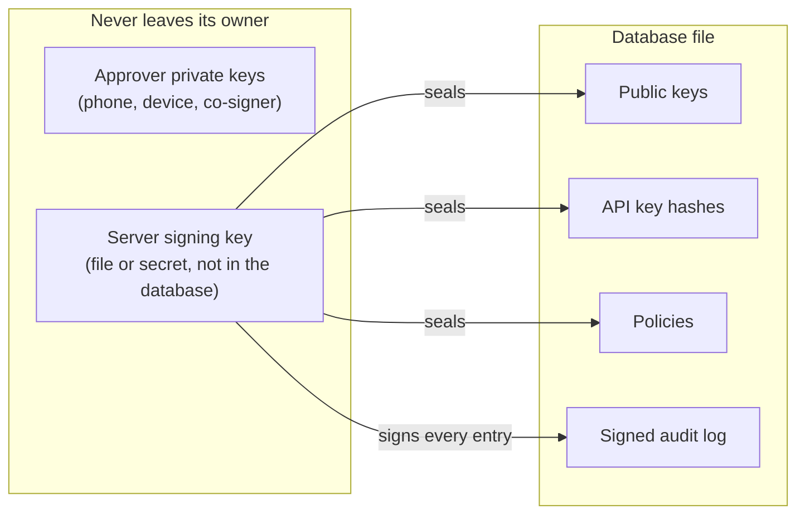
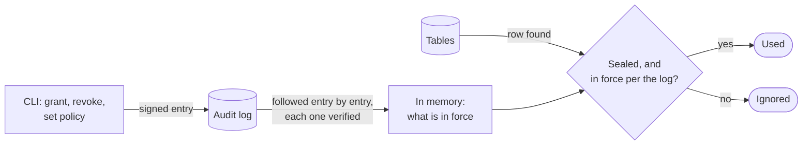

# Architecture

Structure and behaviour of 2F. Wire formats are specified in
[PROTOCOL.md](PROTOCOL.md); the purpose of each defence is given in
[THREAT_MODEL.md](THREAT_MODEL.md).

- [1. Overview](#1-overview)
- [2. Approval sequence](#2-approval-sequence)
- [3. Challenge lifecycle](#3-challenge-lifecycle)
- [4. Signatures](#4-signatures)
- [5. Policy evaluation](#5-policy-evaluation)
- [6. Server internals](#6-server-internals)
- [7. Performance](#7-performance)
- [8. Trust boundaries](#8-trust-boundaries)

## 1. Overview

The calling system does not execute on its own authority. It submits the
action to 2F and executes only when it holds a receipt for that exact action.

## 2. Approval sequence

A withdrawal to an address the rules do not know, approved by a person.

## 3. Challenge lifecycle

Only `allowed` and `approved` produce a receipt. A refusal is final: a later
approval does not revive the challenge.

## 4. Signatures

Every signature covers a hash that leads back to the exact action. Each
structure has its own tag, so a signature made for one purpose is never valid
for another.

Because the approver signatures travel inside the receipt, a client that pins
approver public keys can check them itself. That holds even if the 2F server
is fully compromised.

## 5. Policy evaluation

Conditions fail closed. A condition on a field the action does not carry does
not match; a velocity limit whose history cannot be read does not match; a
policy whose seal does not verify is treated as "deny everything".

## 6. Server internals

`crates/core` has no network, no clock and no disk. Everything that decides
whether an action is authorized lives there and is tested in isolation. The
SDKs in `sdk/` reimplement only the client half (canonical form, hashes,
receipt verification) and are pinned to the core by shared test vectors.

## 7. Performance

A durable commit costs one disk sync, on the order of milliseconds. One sync
per request would limit the server to a few hundred writes per second, so the
writer commits in groups.

- One writer thread owns the only writing connection. Operations never race,
  so single use receipts, velocity limits and the audit chain need no locks.
- Each operation runs in its own savepoint. One refusing does not undo the
  others in its batch.
- No response is sent before the data is on disk (`synchronous=FULL`).
- Reads use a pool of read only connections and never wait for a sync.
- Clients waiting for an approval are woken by the commit that decides it,
  instead of polling.

Measured with `cargo test --release -p twof-server --test bench -- --ignored
--nocapture`, 8 threads, database on disk, on a laptop:

| Operation | Throughput |
|---|---|
| Authenticate an API key | about 240,000 per second |
| Read a pending challenge | about 450,000 per second |
| Create, allow by rule and issue a receipt (durable) | about 3,900 per second |
| Create, approve with a signature and issue a receipt (durable) | about 1,500 per second |

These are in-process figures for the service layer. HTTP adds overhead, and
write throughput depends on the storage device.

## 8. Trust boundaries

The database holds nothing that lets its reader act, and nothing its writer
can use to grant themselves power: credentials, API keys, policies, enrollment
links, notification settings and every challenge are sealed with the server
key and refused when the seal does not verify. Stored approvals are verified
again, signature by signature, whenever a quorum is counted.

The tables are where grants are looked up, but the signed log is what decides
them. The server follows the log entry by entry, checking that each one
continues the last and carries its signature, and keeps in memory what the log
says is in force. A row that the log does not support is ignored, however
genuine its seal; a log that is cut, altered or extended by someone else stops
the server.

